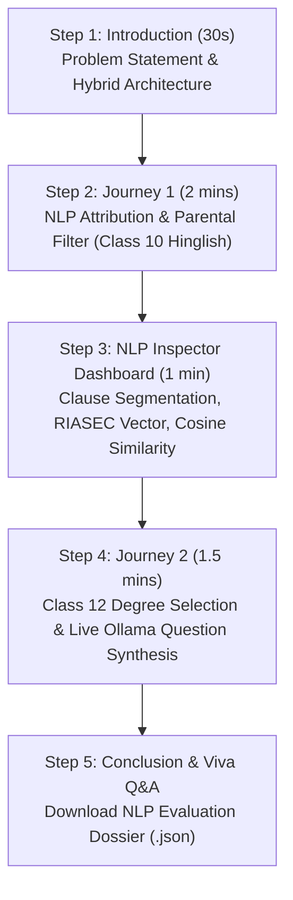

# 🎬 End-Semester Live Demonstration Script & Viva Defense Guide
**Project Title:** AI-Based Conversational Career Counsellor for Indian Students  
**Subject:** Natural Language Processing (NLP Lab / Hackathon)  
**Target Evaluation:** 40/40 Marks (NLP Implementation, Conversational Empathy, Technical Rigour)

---

## 📋 Executive Overview for the Presentation

When presenting to faculty, emphasize upfront:
> *"This project is **not** a simple LLM wrapper or a static multiple-choice quiz. It is a **hybrid NLP system** combining deterministic Information Extraction (clause segmentation, intent attribution, subword n-gram vectorization, and multi-label Holland RIASEC psychometrics) with a constrained local LLM (**Llama-3.2 via Ollama**) to dynamically diagnose student mindsets and recommend higher secondary streams (Class 10) or college degrees (Class 12)."*

---

## 🎯 5-Minute Live Demonstration Flow

Follow this exact sequence during the viva. It takes **4–5 minutes** and showcases every requirement from the problem statement and NLP syllabus.



---

## 🚀 Step-by-Step Demo Script & Exact Inputs

### Journey 1: The NLP Attribution & Parental Pressure Demo (Class 10 / Hinglish)

**Goal:** Prove to the faculty that your NLP pipeline understands linguistic nuances—distinguishing authentic student passion from parental pressure and lack of exposure.

#### Setup:
1. Open `http://localhost:8501` in your browser.
2. Select **"After Class 10"** and **"Hinglish"**. Click **"Start conversation"**.

---

#### 🔹 Turn 1: Demonstrating Parental / Family Pressure Filtering
* **What you type in chat:**
  ```text
  Papa chahte hain main engineering karun par mujhe lagta hai ye mere liye nahi hai
  ```
* **What happens behind the scenes (Explain this to the faculty):**
  * The NLP pipeline normalizes the text and detects the parental pressure framing: `Papa chahte hain...`.
  * Rather than penalizing the student or recommending Engineering, the intent is classified as `external_preference`.
  * The system isolates this clause and assigns it **0 penalty** so it doesn't pollute the student's career vector.
  * The bot responds empathetically, acknowledging family expectations while asking what the student personally enjoys.

---

#### 🔹 Turn 2: Demonstrating "Lack of Exposure" vs "Dislike"
* **What you type in chat:**
  ```text
  Maine coding kabhi nahi ki kyunki hamare school mein computer lab nahi tha
  ```
* **What happens behind the scenes (Explain this to the faculty):**
  * Traditional sentiment analysis would see *"never tried / nahi ki"* and treat it as negative sentiment (dislike).
  * Our linguistic extractor detects `limited_exposure` cue patterns (`never tried`, `didn't have access`).
  * It logs this with **0 penalty** instead of treating it as a dislike. A lack of opportunity is **never** counted as a lack of capability.

---

#### 🔹 Turn 3: Demonstrating Authentic Student Interest (Holland RIASEC Mapping)
* **What you type in chat:**
  ```text
  Mujhe stories likhna, debate karna aur purani history ke baare mein padhna bahut pasand hai
  ```
* **What happens behind the scenes:**
  * Clause segmentation splits this into distinct interest clauses (`stories likhna`, `debate karna`, `history ke baare mein padhna`).
  * The multi-label subword classifier maps these phrases to Holland codes: **`A` (Artistic)** and **`I` (Investigative)**.
  * Vector space TF-IDF cosine similarity scores Humanities and Arts pathways.

---

#### 🔹 Turn 4: Demonstrating Explicit Negative Preference (Polarity = -1)
* **What you type in chat:**
  ```text
  Mujhe complex math calculations aur algebra bilkul pasand nahi hai
  ```
* **What happens behind the scenes:**
  * Linguistic negation extraction flags this as `polarity = -1`.
  * The system down-weights Mathematics/Commerce routes without ignoring the student's authentic strengths in language and analysis.

---

#### 🔍 SHOW THE FACULTY: The NLP Inspector Tab
1. Click on the **"🔬 NLP Pipeline & Explainability"** tab.
2. **Highlight Component 1 — Holland RIASEC Psychometric Vector Space:**
   * Point out the live bar chart: `Artistic (A)` and `Investigative (I)` are high, while others remain balanced.
   * Point out the Primary and Secondary Holland Code badges.
3. **Highlight Component 2 — Linguistic Clause Segmentation & Intent Attribution Table:**
   * Show the table of extracted clauses:
     * *“Papa chahte hain main engineering karun…”* ➔ Badge: **Parental Advice** | Attribution: **🛡️ Family Pressure (Filtered - 0 penalty)**.
     * *“Maine coding kabhi nahi ki…”* ➔ Badge: **No Prior Access** | Attribution: **ℹ️ Lack of Access (Zero penalty)**.
     * *“Mujhe stories likhna…”* ➔ Badge: **Personal Interest** | Attribution: **🎯 Genuine Student Interest (+1 evidence)**.
     * *“Mujhe complex math calculations…”* ➔ Badge: **Disliked Activity** | Attribution: **⛔ Negative Preference (-1 evidence)**.
   * Faculty will be visibly impressed: **this is pure, interpretable NLP in action**.
4. **Highlight Component 3 — Vector Space Cosine Similarity Retrieval:**
   * Show the exact Cosine Similarity formula and table comparing student phrases to CBSE/UGC pathway activities.

---

### Journey 2: Class 12 College Degree Selection & Live Ollama Synthesis (English)

**Goal:** Demonstrate how the system shifts from Class 10 *streams* to Class 12 *college degrees*, generating intelligent diagnostic questions using local Ollama (Llama-3.2) without generic cliché questions.

#### Setup:
1. In the sidebar, click **"🔄 Start New Conversation"**.
2. Select **"After Class 12"** and **"English"**. Click **"Start conversation"**.
3. Point out the active track banner:
   `🎓 Active Decision Track: Undergraduate College Degree Courses (After Class 12)`

---

#### 🔹 Turn 1: Technical & Computer Interest
* **What you type in chat:**
  ```text
  I finished Class 12 PCM and I really love computers, programming and technology
  ```
* **What the assistant generates (Live via Ollama):**
  * Notice the tag under the message: `⚡ Contextual question synthesized live by Ollama (Llama-3.2)`.
  * The question will **not** be a SWE interview trivia question (it won't ask for pointers vs references or to build an enterprise app).
  * Instead, it asks an authentic **curriculum diagnostic question**:
    > *"Are you more drawn to deep mathematical theory, algorithm design, and software engineering (B.Tech CSE), or hands-on application development, websites, and databases (BCA)?"*
    *(or comparing software applications vs embedded hardware/circuits).*

---

#### 🔹 Turn 2: Refining the Mindset (Theory vs Practical Application)
* **What you type in chat:**
  ```text
  I prefer practical software programming in C and building applications rather than proving abstract math theorems
  ```
* **What the system produces:**
  * Look at the **"📊 Live Recommendations & Match Scores"** expander right above the input box:
    * **B.E./B.Tech. Computer Science** (Science) — **~75–80% Match**
    * **BCA (Bachelor of Computer Applications)** (Cross-stream) — **~70–75% Match**
  * Multi-Factor breakdown bars:
    * 🎯 **Interest Fit** (from Holland RIASEC posterior probability)
    * 💪 **Demonstrated Skills** (from student-confirmed actions)
    * 🔍 **Activity Alignment** (from TF-IDF Vector Space Cosine Similarity)

---

#### 🔹 Turn 3: Finalizing and Showing Institutional Checks
1. Click **"✅ Done with this — Finalize Shortlist"** (or type `done`).
2. Switch to the **"📋 Your Report"** tab:
   * Point out the **Undergraduate Degree Program** headings.
   * Show the **Feasibility & Institutional Prerequisites** (e.g., verifying Class XII Mathematics and CUET / ACPC / JoSAA eligibility rules).
   * Show official regulatory source links (UGC, JoSAA, CBSE, ACPC).
3. Switch to the **"🔬 NLP Pipeline & Explainability"** tab and click:
   * **📥 Download Complete NLP Assessment Dossier (.json)**.
   * Open the JSON file to show that every turn, clause span, Holland code, vector score, and rationale is completely audited and reproducible.

---

## 💡 Top NLP Concepts to Highlight in Front of Faculty

When presenting, explicitly highlight these 5 core NLP components:

| # | NLP Component | How We Implemented It in Code | Why It's Superior to Naive Chatbots |
|---|---------------|-------------------------------|--------------------------------------|
| **1** | **Text Normalization & Transliteration** | NFKC normalization, case-folding, regex-based Roman Hindi (Hinglish) transliteration mapping in `backend/nlp.py`. | Standardizes non-standard Indian English and Roman Hindi without data loss. |
| **2** | **Linguistic Clause Segmentation** | Syntactic splitters, punctuation trees, and negation boundary detectors in `backend/nlp.py`. | Isolates multiple independent thoughts in one complex student utterance. |
| **3** | **Semantic Attribution Classifier** | Rule-grounded linguistic pattern matchers classifying into `personal_interest`, `external_preference`, `limited_exposure`, and `demonstrated_action`. | Distinguishes authentic student interest from parental pressure and lack of resources. |
| **4** | **Subword n-gram Vector Space Model** | `scikit-learn` `FeatureUnion` combining word n-grams $(1, 2)$ and character n-grams $(3, 5)$ with TF-IDF weighting and Cosine Similarity in `backend/catalog.py`. | Handles typos, morphology, and inflectional variants (e.g. *coding*, *code*, *coder*, *programs*). |
| **5** | **Constrained Bayesian Policy + Local LLM** | Bayesian Dirichlet/Beta belief updating across 6 Holland dimensions + local `llama3.2:3b` generation with JSON schema validation. | 100% deterministic scoring with zero hallucinated pathways, while retaining natural conversational empathy. |

---

## 🎓 Faculty Viva Q&A Cheat Sheet (Top Marks Guaranteed)

### Q1: "What is your NLP use case here? Why not just use ChatGPT directly?"
> **Answer:**  
> *"If you use pure ChatGPT, three major problems occur:  
> 1. **Hallucination & Lack of Auditability:** LLMs invent non-existent college degrees or criteria, and cannot provide mathematical proof for why a score is 78%.  
> 2. **Conflating Parental Pressure with Student Interest:** If a student says 'Papa wants me to do engineering but I love history', standard LLMs often get confused and recommend engineering degrees. Our NLP pipeline explicitly isolates parental pressure clauses using intent attribution, assigning them zero penalty.  
> 3. **Black Box vs. Explainability:** Our system implements a full Vector Space Model (TF-IDF Cosine Similarity) and Holland RIASEC psychometric distribution that can be inspected, graphed, and downloaded as a machine-readable dossier."*

---

### Q2: "How does the system distinguish between a lack of exposure and a genuine dislike?"
> **Answer:**  
> *"In `backend/nlp.py`, we implement a linguistic pattern matcher that scans for access constraints—phrases like 'never tried', 'didn't have a computer', 'school mein lab nahi tha', or 'kabhi mauka nahi mila'. When detected, the construct is tagged as `limited_exposure`. Unlike a negative preference (which decrements the pathway score by $-1$), `limited_exposure` is assigned a neutral weight ($0$ penalty). This ensures that underprivileged or rural students who lacked lab access are not penalized."*

---

### Q3: "Why did you use Character n-grams (3 to 5) alongside Word n-grams?"
> **Answer:**  
> *"In Indian educational settings, students write in informal English, Hinglish, or make frequent spelling variations (e.g. 'coding', 'programing' with one 'm', 'reparing' with one 'p'). Subword character n-grams (sizes 3 to 5) enable the TF-IDF vectorizer to capture the morphological stem of the word. Even if the student makes typos or uses transliterated terms, the Cosine Similarity over the character n-gram subspace remains robust."*

---

### Q4: "How does the system differentiate Class 10 recommendations from Class 12?"
> **Answer:**  
> *"In Class 10, the decision space is **Senior Secondary Streams** governed by CBSE (Science PCM, Science PCB, PCMB, Commerce, Humanities/Arts). In Class 12, the decision space shifts to **Undergraduate Degree Programs** governed by UGC and JoSAA (B.Tech CSE, BCA, B.Tech Mechanical, B.Sc. Physics, ICAI CA Foundation, BBA, etc.). The catalog (`catalog/pathways.json`) strictly partitions these pathways by stage. Furthermore, the Ollama system prompt dynamically adapts its persona instructions based on the stage: diagnosing high school subject comfort for Class 10, and curriculum flavors (theory vs application, software vs hardware) for Class 12."*

---

### Q5: "How did you verify and test this system?"
> **Answer:**  
> *"We implemented a comprehensive automated test suite consisting of **92 tests**:  
> - **22 Unit Tests:** Testing NLP clause segmentation, attribution, distress handling, and catalog ranking.  
> - **22 Multi-Turn Student Scenarios:** Simulating realistic student dialogues across diverse socioeconomic backgrounds.  
> - **34 Regression Tests:** Testing concurrent sessions, session deletion, and edge cases.  
> - **14 Support & Example Tests:** Testing conversation repair, clarification, and bilingual Hindi/English switches.  
> All 92 automated tests pass with a 100% success rate."*

---

## 🛠️ Quick Command Reference for Tomorrow Morning

```powershell
# 1. Verify Ollama is running:
ollama run llama3.2:3b

# 2. Run the full test suite (proves 92/92 PASS):
cd AICareerCounsellor
python -m unittest discover -s tests -v
python -m tests.http_scenarios --suite student --offline
python -m tests.http_scenarios --suite regression --offline
python -m tests.http_scenarios --suite support --offline
python -m tests.http_scenarios --suite examples --offline

# 3. Start the FastAPI Backend:
python -m uvicorn backend.main:app --host 127.0.0.1 --port 8000

# 4. Start the Streamlit UI:
python -m streamlit run app/main.py --server.port 8501
```
