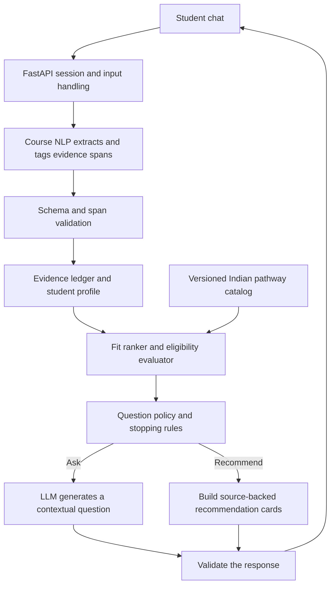

# AI career counsellor for Indian students

Research and implementation plan · 22 November 2026

[Architecture](#3-architecture-and-per-turn-flow) · [Coursework NLP](#31-nlp-coursework) · [Question policy](#4-evidence-model-and-dynamic-question-policy) · [Datasets](#6-datasets-and-how-to-build-them) · [Colab](#7-model-training-and-the-free-colab-budget) · [Evaluation](#8-experiments-and-acceptance-criteria) · [Docker](#101-docker-compose-deployment) · [Schedule](#11-six-week-implementation-sequence)

## 1. What to build

Build a text-first counsellor for two decisions. After Class 10, recommend a **stream, subject combination, and a domain to explore**. After Class 12, recommend a **degree or professional route, a specialization, and an alternative**. Give one lead recommendation when the evidence supports it. Each result should explain the fit using what the student said, show the trade-offs, and name a next step they can take this week. If the evidence is mixed, show the leading options and the question or activity that would help resolve the choice.

Build and evaluate a domain-specific NLP pipeline for English and Hinglish evidence extraction and activity retrieval. Use the existing local Ollama installation to phrase dynamic follow-ups and benchmark evidence extraction. Train the project's lightweight text classifier on CPU in a Python virtual environment. Python decides what evidence to seek, how answers change the shortlist, and which admissions facts can be asserted. Start with **CBSE and a curated Gujarat coverage slice** and about **35–45 pathways**, including Gujarati Literature. Add Hindi and Gujarati response support after native-speaker review. This scope assumes a student-led project, a six-week build, and no guaranteed access to school participants or paid inference. Confirm the course's rules on pretrained models and disclose the use of Qwen and any model-generated data in the report.

| Student's decision | Output | Coverage in the prototype |
| --- | --- | --- |
| After Class 10 | Lead stream and combination, immediate subject-choice check, domains the combination keeps open | Science with Maths and/or Biology where offered, Commerce with or without Maths where offered, Humanities/Arts with relevant electives, plus cross-stream and vocational options where verified |
| After Class 12, Science | Lead degree and specialization, alternative, and institution-specific prerequisites where available | B.E./B.Tech. in Computer Science, Mechanical or Civil Engineering, and B.Sc. routes in Physics, Chemistry, Mathematics and Life Sciences |
| After Class 12, Commerce | Lead degree or professional route, focus area, and alternative | B.Com., BBA, Finance, and the CA Foundation route, with sample focus areas such as accounting, business analytics and management |
| After Class 12, Humanities/Arts | Lead degree and discipline, alternative, and institution-specific prerequisites where available | Economics, Psychology, English Literature, Gujarati Literature, and selected design, communication and vocational routes |

Use the stream name as an organizing label. The actionable Class 10 recommendation is a combination of subjects the student's school actually offers. For example, Economics can lead to different undergraduate routes with different mathematics requirements. The graph should keep such pathways connected across stream labels. [NCERT National Curriculum Frameworks](https://ncert.nic.in/focus-group.php?ln=en) · [CBSE Class XI–XII curriculum, 2026–27](https://cbseacademic.nic.in/curriculum_2027.html) · [UGC undergraduate curriculum framework](https://www.ugc.gov.in/KeyInitiative?ID=yiPY1rgAlvz9%2F1chFf86gg%3D%3D)

## 2. Research contribution

**Can a counsellor that generates questions to resolve the student's most consequential uncertainty reach an equally good or better shortlist in fewer turns than a general-purpose LLM or a policy that seeks only broad RIASEC coverage?**

At each turn, estimate what could change the advice. If two leading pathways differ mainly in whether the student enjoys quantitative modelling or interpreting interviews, generate an accessible scenario that distinguishes those activities. If the preferred pathway is clear but a school subject combination is uncertain, use the turn to verify availability. If the student mentions a subject because of family expectations, ask about a concrete activity they chose themselves and record family preference separately. The resulting explanation can show which answer changed the shortlist, what evidence supports the lead, and what would make an alternative a better choice.

Adaptive item selection, conversational recommendation, and chatbot-based RIASEC assessment already exist. The proposed contribution is a **decision-focused question policy for Indian school-to-degree decisions** that separates intrinsic fit from access and admissions, and links every recommendation to student evidence and source-backed rules. The claim is about the measured effect of that combination. An LLM paraphrasing questions or an attractive demo would provide no evidence for that effect. [Adaptive item-selection research](https://doi.org/10.1007/s11336-008-9097-5) · [Conversational recommendation prompting study](https://aclanthology.org/2025.coling-main.561/) · [Chatbot-based vocational interest assessment](https://doi.org/10.5465/AMPROC.2025.25bp) · [Sankalp career guidance system](https://doi.org/10.1109/ACCESS.2025.3638596)

Test three hypotheses.

1. At a common turn budget, selecting questions for expected improvement in the shortlist improves counsellor-rated recommendation quality over matched adaptive baselines.
2. Keeping **enjoyment, demonstrated actions, exposure, family preferences, and feasibility** distinct reduces unsupported inferences on pressure and unequal-access cases without worsening shortlist quality.
3. Turning uncertainties into small, accessible activities yields more specific next steps and lets the student revise the recommendation after trying something. Treat decision clarity and activity follow-through as exploratory pilot outcomes.

## 3. Architecture and per-turn flow



1. **Start the session.** Ask for a short description of the student's decision if it is unclear, then infer the stage or confirm it. Invite the student to write in their preferred language. Ask for board, subjects, or region only when the pathway decision needs them. The chat allows skip, correction, and an early provisional summary.
2. **Extract evidence.** Tokenize and propose spans from the newest reply, tag the spans with the course NLP pipeline, and verify the speaker, polarity, and evidence type. Use the preceding question to resolve short replies such as “the first one” when the referent is clear, and retain the exact answer span plus a reference to the earlier question. A generic answer such as “Science is nice” leaves relevant dimensions uncertain and triggers a neutral follow-up. Evaluate prompt-only extraction from Qwen as a comparison. If the native pipeline is uncertain, clarify before updating the interest estimate.
3. **Update and rank.** Deduplicate evidence by activity and turn. Update the RIASEC interest estimate, the evidence for strengths, and known constraints. Recompute the stage-specific shortlist and the status of each sourced admission rule.
4. **Choose the next intent.** Score plausible clarification, comparison, contradiction, exploration and feasibility intents. An intent specifies what the reply should help distinguish. The LLM generates a question for the winning intent using a detail from this conversation. An initial invitation can be generic and generated. The production flow has no fixed quiz or queue of stored assessment prompts.
5. **Validate and respond.** Check that the result has one clear question, uses the student's language, is neutral toward the options, and avoids an unsupported assumption. Retry once with feedback on the failed check. A deterministic renderer can compose a clarification from the actual evidence phrase or missing field if the generator fails. When the model is unavailable, preserve the turn for retry or show the latest provisional summary. Track fallback rate in evaluation.
6. **Explain and revise.** Generate the report from approved pathway IDs, validated evidence IDs, and source records. Use an editable summary so the student can correct a misunderstood preference. Supersede the disputed evidence and replay the active ledger to recompute scores. Record the before-and-after ranking for the session.

### 3.1 NLP coursework

The coursework contribution is an independently evaluated **English/Hinglish evidence extractor**. Its input is a student reply with limited question context. Its output includes the original text span, who holds the preference, polarity, evidence type, and zero or more RIASEC tags. For example, in “Papa chahte hain main engineering karun, but mujhe surveys ka data dekhna pasand hai,” one clause records a family preference and the second can support Investigative interest. This distinction changes what the counsellor asks and recommends.

1. **Normalize and tokenize.** Use Unicode-aware tokenization and preserve original character offsets. Build a small versioned glossary for Hinglish spelling variants and English/Indian education terms. Represent aliases as features, and preserve negation and attribution cues such as `not`, `nahi`, `mujhe`, and `parents want`. Propose clauses using punctuation and contrast markers. Hand-label missed, fuzzy, and short contextual responses to measure where clause segmentation fails.
2. **Train a sparse text classifier.** Fit word unigrams and bigrams and character 3–5-grams with TF-IDF on the training partition. Train logistic-regression heads on candidate spans for evidence type and one-vs-rest RIASEC labels. Use explicit speaker and negation cues as additional features, with conservative rules for scope conflicts. Use reviewed clause-level examples from Section 6, including `no_evidence`, family pressure, limited exposure, and explicit dislike. Apply validation-set thresholds for abstention. Unknown or conflicting spans trigger a follow-up or no update. Save the vectorizers, models, thresholds, and dataset hash as versioned CPU-built artifacts. [scikit-learn TF-IDF documentation](https://scikit-learn.org/stable/modules/generated/sklearn.feature_extraction.text.TfidfVectorizer.html)
3. **Retrieve relevant activities.** Index original catalog descriptions and reviewed aliases using word and character TF-IDF. Compare student evidence against those vectors with cosine similarity to retrieve candidate activities or pathways. Use matches to expand the shortlist and choose meaningful comparisons. Keep the structured ranker and verified eligibility rules in charge of recommendations, and retain profile-based candidates when sparse retrieval yields weak matches. Measure recall@5 and mean reciprocal rank on separately labelled evidence-to-activity queries. Dense embeddings are a possible comparison if lexical retrieval misses many paraphrases.
4. **Measure the contribution independently.** Compare glossary/rules, word-only, character-only, combined sparse features, and prompt-only Qwen extraction on the same profile-family holdout. Report exact and overlapping span F1, macro-F1 for evidence type and RIASEC tags, speaker/negation errors, and accuracy versus abstention coverage for each language slice. Also replay the classifier and LLM extractors through the same question generator and ranker to measure the difference in final shortlist quality. Use human-authored test cases and fit text features only on training data. Report where the pretrained model and custom model each perform better.

### Implementation stack

| Layer | Initial choice |
| --- | --- |
| Interface | Streamlit chat and report cards for the prototype, with correction and skip controls |
| Backend and NLP | FastAPI, Pydantic, NumPy, scikit-learn and SQLite in the local Python environment |
| Catalog | Versioned YAML or CSV reviewed through Git, imported into SQLite, with a sparse activity index |
| Generation | Local Ollama with 4-bit `qwen3:1.7b` at `http://127.0.0.1:11434`. Use it for contextual question generation and extraction benchmarks. Keep model, prompt and decoding versions in traces. |
| Evaluation | Python CLI for replay, closed-loop simulation, scoring, and ablations, with JSONL results and a generated metrics report |

Suggested interfaces are `POST /sessions`, `POST /sessions/{id}/turns`, `PATCH /sessions/{id}/evidence/{id}`, `GET /sessions/{id}/recommendations`, and `DELETE /sessions/{id}`. Use a client turn ID and expected session version to handle retries and concurrent edits. Persist the user turn, active evidence, updated state, and validated reply atomically after inference, rejecting a stale state write. Test schema failures, duplicate submissions, and correction replay. [Qwen3-1.7B model card](https://huggingface.co/Qwen/Qwen3-1.7B) · [Qwen3-4B-Instruct-2507 model card](https://huggingface.co/Qwen/Qwen3-4B-Instruct-2507)

## 4. Evidence model and dynamic question policy

### 4.1 Measure interests and support strengths with different evidence

| RIASEC dimension | Activities to recognize in student stories |
| --- | --- |
| Realistic | Building, repairing, handling materials, or hands-on experiments |
| Investigative | Investigating causes, reasoning with data, or testing explanations |
| Artistic | Writing, performing, designing, or interpreting creative work |
| Social | Teaching, supporting, listening to, or working collaboratively with people |
| Enterprising | Persuading, initiating projects, coordinating people, or making decisions |
| Conventional | Organizing records, checking details, following structured processes, or handling accounts |

Holland’s RIASEC framework describes six dimensions of **vocational interest**. Keep independent evidence about **thinking style and demonstrated or self-reported strengths**, such as how the student compared data, explained an idea, led a project, or debugged a design. Distinguish what a student chose, what they had access to, and what someone else wants for them. A grade can supply academic context if volunteered. It should have no direct effect on the interest scores. A student who has never coded has supplied an exposure fact. In that case, a comparable everyday activity or a tiny trial can produce better evidence. For Class 9–10 aptitude testing, use NCERT's Tamanna as background on the distinction between interest and aptitude. The chat's strength indicators remain exploratory. [O*NET Interest Profiler Technical Manual](https://www.onetcenter.org/reports/IP_Manual.html) · [NCERT Tamanna](https://ncert.nic.in/tamanna/index.html)

Example record from the evidence ledger:

```json
{
  "id": "e17",
  "turn_id": "t6",
  "span_text": "I compared our class survey responses in a spreadsheet",
  "activity_key": "class-survey",
  "construct": "demonstrated_action",
  "tags": ["quantitative_reasoning", "data_organization"],
  "polarity": "positive",
  "specificity": "concrete",
  "source": "self_report",
  "status": "active"
}
```

In implementation, also index span offsets, language, negation, attribution, and superseded IDs. Allow multiple interpretations of an activity while capping the total weight contributed by that evidence group. Distinguish self-described completed actions from outcomes directly observed in a short activity. Apart from quoted evidence, save factual context as typed fields with provenance. A student's “my parents want engineering” can create an external preference record and can motivate a sensitive follow-up. It contributes zero evidence for the student's interest in engineering. Treat an explicit skip, a vague answer, and a contradictory answer as different outcomes.

### 4.2 Start with transparent uncertainty

Use six independent Beta distributions initialized to `Beta(2, 2)` as an engineering approximation. For explicit enjoyment or aversion, apply weighted pseudo-counts to the relevant dimension. A specific voluntary example with explicit enjoyment can start at weight `1.0`, a general preference at `0.3`, and an ambiguous, unexposed, or third-party preference at `0`. Use analogous negative evidence for explicitly disliked activities. Cap the summed update from the same activity across turns, and require independent examples before claiming strong support. Calculate results from active ledger entries so corrections can decrease or reverse an earlier update. Display the student's words and qualitative uncertainty. The numerical spread at this stage is an internal scheduling signal, with no claim of population norms or psychometric calibration.

For each catalog pathway, estimate fit from a transparent rubric. Start with **55% interest alignment, 25% evidence for relevant strengths, and 20% work- and study-style preferences**. Represent each pathway with typical day-to-day study and work tasks. Calculate interest alignment using a weighted mean of the six interest dimensions with expert-reviewed pathway weights summing to one. Unknown evidence gets a neutral center with wider plausible values. Sample plausible profiles to estimate rank stability. Record disagreement between reviewers over pathway weights and test sensitivity to meaningful weight changes. Keep fit, feasibility, and the amount of evidence visible as separate fields. These weights are initial design choices to ablate on validation data.

### 4.3 Select a question for its effect on the decision

Create 4–8 candidate **intents**, each identifying a target construct, what the options disagree on, and a reference to an earlier turn. An intent can also identify an unresolved prerequisite or an underexplored domain. Estimate the probability of each answer outcome with a small response model. For a preference comparison, use a logistic function of the current sampled preference gap, with explicit mixed and skip outcomes. For a feasibility check, use a separate categorical model over known, unresolved, and skipped answers. For each possible outcome, simulate the update and recompute the decision loss. Use the same 128–256 profile draws across intents for a stable comparison.

Define loss over a small decision set, such as issuing a lead recommendation, offering a two-path shortlist, or keeping an option conditional. A wrong strong lead incurs a fit regret cost. An unsupported eligibility claim incurs a larger penalty. A conditional result incurs a smaller cost for leaving a necessary step unresolved. Derive the actionable options from the rule engine before evaluating the loss, so an unverified path can be presented conditionally. Estimate question value as:

```text
value(q) = current expected decision loss
           - sum_over_outcomes P(outcome | q, state) * expected loss after outcome
           - estimated burden(q) - repetition(q) + coverage bonus(q)
```

Loss after an outcome is the best expected loss achievable by the policy after that update. In the first implementation, map each hypothetical answer to a proposed ledger observation and use the same update and ranking functions used for real replies. For example, “skip” emits no evidence and “both” can yield modest signals for each activity rather than a decisive preference. Start with rubric-defined costs in normalized fit-score units and report sensitivity to them. For a worked toy case, if current loss is `0.24`, the post-answer losses are `0.08`, `0.09`, and `0.24`, and their outcome probabilities are `0.45`, `0.35`, and `0.20`, then the expected reduction is `0.1245` before question costs. Fit response likelihoods from independently reviewed simulation profiles or an approved pilot if enough labels become available, and report which evaluation used each estimate. Until calibrated, treat expected loss as a ranking heuristic and compare it with a simpler uncertainty × pathway-disagreement policy. The LLM writes the selected question after scoring. The first implementation therefore avoids relying on an LLM to predict the value of its own wording.

Make the generated scenarios equally concrete, plausible, and low-cost. Compare two activities with similar access and effort. Ask whether the student would prefer either, both, or neither when that is the intended distinction. Vary the scenario with contexts such as a class survey, local shop inventory, hobby repair, or scriptwriting. Reserve early exploration for distinct domains and allow a newly supported pathway to enter the shortlist. This prevents the first answer or the most popular pathway from dominating the whole conversation.

### 4.4 Decide when to recommend

Start with a target of 6–10 substantive student turns and a cap of 12. Permit an evidence-backed lead when there are at least two independent fit signals, reasonable domain exploration, no unresolved contradiction that could reverse the fit ranking, and the lead wins at least 70% of sampled plausible profiles. Describe any unresolved admissions condition separately. Tune the 70% internal threshold on validation cases against lead coverage and error, and report sensitivity. If it stays inconclusive, show two routes, the actual trade-off, and one low-cost activity or source check. If the student requests a result immediately, show a provisional report from the available evidence and let them resume. Describe uncertainty in terms of the missing evidence or unresolved choice.

## 5. The Indian pathway catalog

Use a typed graph stored as tables. A catalog entry represents a pathway, such as `science_pcm → engineering → be_btech → civil`. A school offering is an instance of a subject bundle. An institution's degree is an instance of a program family. Link subjects, programs, occupations, alternative routes, and evidence sources with many-to-many edges. One program may have multiple entry routes, and similar program names may have different prerequisites.

| Record | Required fields and behaviour |
| --- | --- |
| `pathway` | Stable ID, stage, stream and aliases, subject-bundle ID if relevant, domain, specialization, route type, typical activities, expert-reviewed interest and skill weights |
| `offering` | Board or institution, program or subject combination, region, cycle, medium if verified, availability status, source IDs |
| `rule` | Target offering or route, authority and scope, cycle, rule-group ID, structured predicate, source ID, reviewer and review status |
| `occupation_link` | Pathway ID, NCO code and optional O*NET-SOC crosswalk, mapping rationale, mapping type, reviewer |
| `source` | Publisher, exact URL, title, retrieval and publication dates, cycle, page or section anchor, license or reuse status, verification state |
| `exploration_activity` | Target distinction, time and access needs, alternative without paid tools, reflection prompts. The scenario and wording are generated from the session. |

Support `all_of` and `any_of` rule groups. Predicates can check completed subjects, exams, stage, or institution-specific conditions. Evaluate in three-valued logic. `all_of` becomes unmet if any required component is known to fail and unknown if some required facts are missing. `any_of` becomes met if a complete equivalent route is satisfied and unmet only if every route is known to fail. Publish statuses as **recorded conditions met**, **recorded condition unmet**, or **verification needed**. A stale source, missing context, or unresolved conflict produces verification needed. Check exam participation rules separately from institution admission eligibility. A positive eligibility flag covers only the verified conditions in that rule's scope. It conveys no prediction of selection or admission. If a constraint blocks a high-fit pathway, show why and surface an available alternative or a source-backed bridge route.

Seed the catalog by hand before automating ingestion. Begin with roughly 35–45 pathways, 8–12 subject bundles, and 10–15 verified institution or professional-route examples. Two reviews are valuable: one to check educational terminology and prerequisites, and one to review the typical activities and fit rubric. Prompt a human editor to review any source change instead of automatically promoting parsed rules. Pin a catalog release for experiments. For advising, verify applicable cycle and authority before using a claim, and retain a review date plus official deep link. [JEE Main bulletins](https://jeemain.nta.nic.in/information-bulletin/) · [JoSAA business rules](https://josaa.nic.in/information-bulletin/) · [CUET UG bulletins](https://cuet.nta.nic.in/information-bulletin/) · [Delhi University programme-specific eligibility FAQ](https://admission.uod.ac.in/userfiles/downloads/2026/17052026_Updated_FAQsUG%202026-final.pdf) · [ICAI New Scheme of Education and Training](https://icai.org/post/19126) · [Gujarat ACPC engineering guidelines](https://gujacpc.admissions.nic.in/guidelines-be_b-tech/) · [Gujarat University affiliated undergraduate programmes](https://www.gujaratuniversity.ac.in/Programme/AffiliatedProg/UG)

## 6. Datasets and how to build them

### 6.1 External sources

| Source | Use | Limits and reuse |
| --- | --- | --- |
| [O*NET Database](https://www.onetcenter.org/database.html) and [database licence](https://www.onetcenter.org/license_db.html) | Download a versioned Career Interests, Work Activities and occupation titles snapshot. Use it to seed occupation profiles and candidate task tags. | US occupational data. Review mappings in India and retain source IDs. Attribute under CC BY 4.0 only for covered material and record modifications. |
| [O*NET Interest Profiler manual](https://www.onetcenter.org/reports/IP_Manual.html) and [tools licence](https://www.onetcenter.org/license_tools.html) | Construct definitions, validity literature, and potential independent agreement benchmark after language and population fit review. | Tool content has separate terms. The published instrument has a no-derivatives licence and modifications can use the separate developer licence, which requires attribution and validation. Keep instrument items and derivatives out of the training corpus and deployed question system. |
| [India NCO 2015](https://www.dge.gov.in/nco-2015) and [NCS career services](https://ncs.gov.in/about-us) | Indian occupational codes, role terms and locally relevant examples for curated crosswalks. Link to NCS for counsellor access. | Review mappings manually. Publish original summaries and citations or use text with documented reuse permission. These sources don't provide training conversations or individual career outcomes. |
| [CBSE](https://cbseacademic.nic.in/curriculum_2027.html), [GSEB](https://gseb.org/), [NIOS academic prospectus](https://cdn.nios.ac.in/cms/documents/2026/Oct/18/1792322980_Academic_Prospectus_2026-27.pdf), [UGC](https://www.ugc.gov.in/KeyInitiative?ID=yiPY1rgAlvz9%2F1chFf86gg%3D%3D), plus the admissions sources in Section 5 | Build typed entries and cite evidence for board-specific and institution-specific claims. Start with checked subsets of CBSE and Gujarat. Use NIOS only for an explicitly verified route. | Source discovery or rule extraction. Keep current facts out of model weights. Confirm school-level offerings with the student or school. |
| [AISHE institution directory](https://dashboard.aishe.gov.in/) | Discover institutions and course families to verify on official institutional pages. | Coverage and reporting may lag. Use as a discovery source, with no role in personal fit scores or admissions verification. |
| [AI4Bharat IndicTrans2 / BPCC / IN22](https://github.com/AI4Bharat/IndicTrans2), [IndicLID](https://github.com/AI4Bharat/IndicLID), [L3Cube HingCorpus paper](https://aclanthology.org/2022.wildre-1.2/) | Optional translation and language-detection baselines, native and Roman-script test coverage, and design of a Hinglish robustness set. | Check reuse terms at subset and upstream-source level, especially for mined or social-media text. Default to original bilingual rewrites for domain training. Have native speakers check terminology, negation, context, and code-mixing. |

Keep a manifest with `source`, `release_or_hash`, `retrieved_at`, `licence`, `allowed_use`, and `transformation`. Default to linking and original paraphrases when reuse terms for external material are unclear. The public datasets above cover occupation and education knowledge, instrument background, or language. The project needs its own labelled conversational corpus for domain-specific learning and evaluation.

### 6.2 Create three project datasets

| Dataset | Target and role | Labels and creation process |
| --- | --- | --- |
| **Counselling dialogue corpus** | Author 50–80 reviewed seed conversations, then generate 500–1,000 synthetic conversations if training is justified. About 2,000–4,000 curated turn-level examples is a reasonable target for a first supervised iteration. | Begin with an authored profile specifying stage, activities, conflicting constraints, language and plausible options. Simulate a student revealing information over multiple turns. Vary uncertainty, vagueness, explicit dislike, corrections, family pressure, interests across streams, and limited exposure. Label exact spans, constructs, next intents, candidate questions and why they help. Add negative examples for easy shortcuts such as overreading marks or mistaking parent preference for student interest. |
| **Decision and robustness benchmark** | Hold out around 120 independent human-authored profiles for policy testing and add roughly 100 paired challenge cases. Scale these counts to reviewer availability and report actual totals. | Include both stages and difficult confusable routes. Reviewers label plausible leads and alternatives, critical uncertainty, eligibility under a pinned catalog, and expected behaviour on paired variants. Hold out scenario families, including some Hindi/Gujarati behaviour for later release assessment. Include source-mismatch and stale-cycle cases. Freeze reviewed alternatives before evaluating policies. |
| **Pathway and rule regression set** | At least 80 decision fixtures covering known, unknown and unmet predicates, combined and alternative routes, and revised evidence. | Store typed facts, expected rule state, expected source scope, and assertions such as “skip leaves interest unchanged,” “correction removes historic support,” and “changing a parent's preferred stream does not directly change fit.” |

Use JSONL with `profile_id`, `family_id`, `stage`, `language`, `turns`, `evidence_labels`, `acceptable_intents`, `plausible_path_ids`, `constraint_labels`, `generator_version`, and `review_status`. Split by **profile and scenario family before paraphrasing or translating**. Keep variants together across train and validation, and reserve the independently authored test set. For synthetic data, use reviewer-authored latent profiles, generate multiple student voices, validate schema and span grounding, then human-review every seed and an estimated 10–20% stratified sample of generated cases. Review oversampled high-risk and low-agreement slices. Remove duplicates and regenerate or drop low-quality batches. Double-label a representative benchmark subset, report agreement on construct tags and recommendation ratings, and adjudicate disagreements. Retain acceptable alternatives because this task rarely has a unique correct answer.

Generate several candidate responses for each reviewed turn and retain responses that follow the selected intent, ground themselves in the history, and use age-appropriate language. Train on those targets with a supervised objective. Keep hidden student profile fields out of the model input. Record which teacher generated each example and check its terms for use of generated outputs in training. Train and test teacher independence by avoiding a single model as data generator, simulator and judge. Avoid student social media, scraped personal chats, or outcome labels made from stereotyped stream assignments.

### 6.3 Pilot data, if access is available

Start the research evaluation with adult volunteers trying the product or role-playing a specific recent decision. Use 24–40 participants for an exploratory feasibility pilot if recruitment permits. Treat retrospective role-play as such and report its limitations. Recruit school students only through the institution's approved process with student assent, appropriate verifiable parent or guardian permission, and a clear opt-out and withdrawal path. Collect ratings and minimal coded observations by default. Seek separate permission for retention or training use of any transcript. Never transfer identifiable student material to Colab or an unapproved inference provider. The project can complete an offline benchmark without school access. That benchmark measures system behaviour on authored cases and supports no claim of real-world counselling effectiveness.

## 7. Model training and the free Colab budget

### 7.1 Start with CPU training and local inference

Train the classifier from Section 3.1 locally on CPU. Separately, run prompt-only Qwen extraction for comparison and generation for dynamic questions. Start with `qwen3:1.7b` in Ollama on the RTX 2050. The 4-bit model download is roughly 1.4 GB. Runtime memory also includes the context cache and allocation overhead, so benchmark a single request at a time at a 2,048-token context before increasing it. Use a mock provider in deterministic tests. Reserve LLM fine-tuning for a persistent, measured failure worth an experiment after the core evaluation is complete. A larger prompt-only model is another possible quality comparison if compute allows. [Ollama Qwen3-1.7B listing](https://ollama.com/library/qwen3:1.7b) · [Qwen3-4B-Instruct-2507](https://huggingface.co/Qwen/Qwen3-4B-Instruct-2507)

### 7.2 Optional one-GPU QLoRA recipe

| Setting | First run |
| --- | --- |
| Base and task | `Qwen/Qwen3-1.7B`, fixed revision with non-thinking generation. Fine-tune extraction and contextual question realization with explicit task tags. Allocate most examples to the weaker task after error analysis. |
| Quantization | Frozen 4-bit NF4, double quantization, FP16 mixed precision on T4. Enable gradient checkpointing and the paged 8-bit AdamW optimizer if supported by the tested stack. |
| Adapter | Start at rank 8, alpha 16, dropout 0.05 on attention projections. Increase capacity only when validation shows consistent gains. |
| Batch and context | Microbatch 1 with accumulation 8–16, 768–1,024 tokens initially. Trim by dropping older raw turns after making a grounded state summary. Keep the current reply and relevant question intact. Mask prompt tokens and verify response-only loss on real collated batches. |
| Optimization | Start around `1e-4`, with short warmup and gradient clipping. Run 100–200 optimizer steps first, gradually increasing toward one pass only if projected runtime and validation support it. Compare checkpoints by task quality alongside loss. |
| Resume | Record GPU, base and tokenizer revisions, chat template, dataset hash, dependency lock, seeds, and run config. Save adapter, optimizer, scheduler, scaler where used, trainer and random state every 25–50 steps. Stage local writes first and copy completed checkpoints to private persistent storage. Verify a restart before the full run. |

Use Transformers, PEFT, bitsandbytes, and TRL with versions pinned after a smoke test. Validate the FP16 setup, schema generation and label masks on a small batch. If memory or throughput is poor, shorten context, reduce adapter coverage, or stay with the prompt-only baseline. Train with authored or approved de-identified data only. Keep the ranking policy, pathway catalog and source-based admissions access in code. [QLoRA paper](https://papers.neurips.cc/paper_files/paper/2023/hash/1feb87871436031bdc0f2beaa62a049b-Abstract-Conference.html) · [Hugging Face 4-bit quantization guide](https://huggingface.co/blog/4bit-transformers-bitsandbytes) · [TRL SFT documentation](https://huggingface.co/docs/trl/main/sft_trainer) · [NVIDIA T4 specifications](https://www.nvidia.com/en-us/data-center/tesla-t4/)

### 7.3 Schedule work around observed throughput

Plan for **one active Colab runtime** and interruptible experiments. Colab's free GPU allocation, available hardware and session duration vary. Google's FAQ prohibits using multiple accounts to work around resource restrictions. The six accounts therefore provide no assumed parallel budget or guaranteed five-hour windows. Parallelize catalog work, evaluation preparation and policy ablations on CPU while the one GPU run trains. If guaranteed parallel GPU experiments become necessary, use authorized compute with explicit capacity. Use Colab for notebook experiments and serve the app locally or in an approved deployment environment. [Google Colab FAQ](https://research.google.com/colaboratory/faq.html)

| Experiment | Compute | Budget and exit condition |
| --- | --- | --- |
| E0. Policy and catalog tests | CPU | Run anytime. Deterministic tests pass before GPU work begins. |
| E1. Prompt-only comparison | Local quantized inference or Colab | Start with a 30–60 case validation slice. Log latency, memory and grounding, then select one candidate for further evaluation. |
| E2. Training smoke test | One T4 when available | Target 20–30 optimizer steps, record steps/hour and peak VRAM, and test save/resume. Determine the remaining step budget from the measured rate after reserving time for evaluation and checkpointing. |
| E3. Optional adapter | Same GPU path | Train the smallest useful run in interrupted chunks if necessary. Compare on the same held-out validation cases and promote only when validation targets improve. |
| E4. Evaluation | CPU for scoring. Local or available GPU for generation. | Score pinned baselines and the selected pipeline, with unchanged test prompts and a frozen catalog. Record runtime and token cost per turn. |

For example, if the smoke test measures `90 optimizer steps/hour` and you have two hours available after reserving time for evaluation and checkpointing, the budget is roughly 180 steps. Treat that as a calculation example and use the actual measured rate. If a GPU remains unavailable, ship E0–E1 and CPU-based policy evaluation with the prompt-only model. The research contribution can be tested independently of adapter gains.

## 8. Experiments and acceptance criteria

### 8.1 Separate question selection from model quality

| Variant | What it tests |
| --- | --- |
| B0. Offline fixed interest inventory + catalog | Comparison with a conventional fixed strategy. Use independently authored or appropriately licensed items, match the turn budget, and omit this baseline from the deployed chat. |
| B1. Prompt-only LLM counsellor | Same underlying LLM, stage context, turn limits and catalog candidate snapshots, but free-form question and shortlist decisions. Log its evidence and citations for scoring. |
| B2. Coverage-first adaptive policy | Same extraction, ranker, source rules, and question generator as the proposed system. Select the next question for uncertainty reduction and RIASEC coverage. This is the primary matched comparison. |
| B3. Uncertainty × pathway disagreement | Same system as B2 with a simpler decision-aware scoring heuristic. Establishes whether simulating outcomes and decision loss earns its complexity. |
| Proposed | Score next intents by expected reduction in decision loss, then generate the selected question from the conversation. Evaluate a prompt-only and optional adapter variant separately. |

Run focused ablations for removing the decision-loss term, collapsing pressure and exposure into interest evidence, and removing the ability to correct previously extracted evidence. Independently test frozen versus rephrased comparable question intents for language stability. When comparing the policy variants, keep the model, catalog, fit rubric, and serving prompt identical. Evaluate option value and clinical-sounding certainty independently from response fluency.

### 8.2 Evaluation protocol

1. **Offline replay.** Test exact-span extraction, construct labels, eligibility rules, and ranking on identical text. Score intent coverage against a set of acceptable next intents. A replay can evaluate a turn given an observed reply. It cannot tell how a student would respond to a different question.
2. **Closed-loop simulation.** For each held-out profile, run every variant under the same per-student turn and token budgets. Build a scripted student simulator that reveals only scenario facts responsive to the current intent, with an independent paraphraser for language variation. For free-form questions, use a frozen intent mapping procedure with manual spot checks. Use matched profiles and random seeds. Repeat a subset with a separately prompted simulator and record sensitivity to response style. Keep reference profiles and labels hidden from the counsellor. Score all variants after exactly eight student replies or, if they stopped earlier, score their final report carried forward. Track native stopping behaviour as a separate result. Count unanswerable questions, skips, errors and missing reports in the results.
3. **Blinded human review.** Share normalized reports plus access to observed turns, randomly ordered with the variant hidden. Ask two reviewers, ideally a counsellor and a second trained rater, to rate whether the shortlist fits the observed and reference evidence, correctly handles constraints, and offers a useful next step. Anchor the fit rating on a 0–4 rubric, from unsupported or incompatible to well grounded with a defensible alternative. Let reviewers accept more than one good lead. Double-score a representative subset and report agreement. Have reviewers assess naturalness and empathy separately with chat turns visible.
4. **Exploratory user pilot.** If approved, assign adults at random to B2 or the proposed policy, stratifying by decision stage when possible. Record before-and-after decision clarity on the same self-report scale, ability to explain a recommendation, perceived agency, and whether a voluntary exploration activity was attempted. Report the pilot size, attrition and confidence intervals. Use a later, properly powered and approved study before claiming improvement for school students or long-term career outcomes.

### 8.3 Metrics and release gates

| Dimension | Measure |
| --- | --- |
| Primary research outcome | Paired difference in mean blinded shortlist fit rating versus B2 at eight student turns. Report a student-profile bootstrap 95% interval and results by stage. Predeclare a practically interesting gain, for example 0.25 on the 0–4 scale, before opening the test set. |
| Turn efficiency | Fit by turn, turns until an independently acceptable and grounded shortlist, and rate of acceptable shortlists at the cap. Keep sessions with no acceptable shortlist in the denominator and report their fraction. |
| Recommendation quality | Top-two overlap with reviewed plausible paths, unsupported lead rate, lead coverage versus error, and correct conditional handling of unavailable or unverified paths. Report by stage and language. |
| Evidence quality | Span-level precision/recall/F1, per-construct macro-F1, attribution and negation errors, percentage of rationale claims directly supported by referenced evidence. Evaluate parent/student attribution as its own measure. |
| Question quality | Intent adherence, neutral wording, whether it builds on a specific prior answer, repeated constructs, fallback rate, and human ratings of empathy and clarity. |
| Source integrity | Rule-fixture pass rate, scope and cycle correctness, student-facing factual claim support, and unverified cases promoted to positive eligibility. |
| Stability and fairness | On authored pairs, hold the substantive evidence fixed while changing script, names, pronouns or equivalent resource contexts. Measure relevant rank flips, unsupported inferences and loss of suitable options. When genuine availability changes, expect feasibility to change and fit to stay stable. Publish slice sizes and uncertainty. |
| System performance | P50/P95 turn latency, model memory, token cost, retry rate and correctness on interruption or deletion. |

Initial engineering targets are **100% pass on known safety-critical rule fixtures**, **zero unsupported eligibility claims on the reviewed release set**, **at least 95% evidence-linked rationale claims**, and **at least 90% valid, intent-aligned questions**. Estimate uncertainty around each test-set metric before interpreting differences. Use conversations as the resampling unit when reporting aggregate effects. If the richer policy fails to outperform B3, ship B3 for the prototype and report where the expected-loss policy helped, hurt, or remained inconclusive. If assessors disagree on a label, report that ambiguity and revise the rubric before treating it as a system error.

## 9. Example behaviour for the demo

### After Class 10

> **Student:** Everyone at home says Science. I like economics, I think.
>
> **Counsellor:** It sounds like you're weighing your family's advice alongside your own interests. What part of economics has caught your attention so far?
>
> **Student:** I tracked prices at my uncle's shop to see what sold after a discount. I liked working out what changed.
>
> **Counsellor:** Imagine using that shop's sales sheet for two projects. One asks you to compare which discount worked best. The other asks you to work out why the recorded stock and cash totals don't match. Which would you choose to spend a little more time on, if either?

The second question compares quantitative interpretation and structured accounting inside the student's own example. If further answers show a preference for modelling and the school confirms the offering, the result could lead with **Commerce → Mathematics and Economics where offered → quantitative economics or business analytics to explore**. The result can show Humanities with Economics and an eligible mathematics option as an alternative if the school supports it. For a home activity, give the student a tiny fictional sales sheet and let them write two explanations for a change in demand. Ask which part they wanted to keep exploring. If the school cannot supply Maths, recalculate the available combinations and link any stated downstream prerequisite to a verified program rule.

### After Class 12

> **Student:** I do well in maths, but what I actually enjoyed this year was interviewing my classmates about study habits and comparing their responses.
>
> **Counsellor:** You tried both listening to people's experiences and looking for patterns in what they said. Which part of that project kept you curious enough to spend extra time on it?

If follow-ups support a sustained interest in human behaviour and the student enjoys looking for evidence across interviews, a potential lead is **B.A. Psychology → research methods and behavioural research as an exploration focus**, with a related social-science alternative. Verify the exact degree title and eligibility for each institution shown. If subsequent evidence points toward modelling outcomes across many responses, reevaluate the ranking and surface a relevant Economics or data-oriented route when feasible. The profile should retain both signals so that a revised lead still makes sense to the student.

In both demos, show the evidence snippets, the decisive comparison, the verified or unresolved feasibility status, and a way to correct the report. Include a second case in which the student lacks access or evidence and the system gives two conditional options. Use that case to demonstrate responsible uncertainty and a useful next step.

## 10. Privacy, inclusion, and deployment

- Use a session ID and minimal profile fields. Avoid names, contact details, exact addresses, and full marksheets. Redact incidental identifiers before model calls, and use the redacted student text for extraction and evidence spans. Keep raw chat out of application logs and external analytics. For a demo, retain session data only as needed and implement explicit delete and a documented expiry.
- For any rollout involving minors, have the institution review consent, permitted storage and processing, vendor handling, deletion, and escalation before recruitment. India's DPDP Act treats a person under 18 as a child. The November 2025 commencement notification phases in Section 9 alongside other provisions at 18 months from publication, and the 2025 Rules phase in the relevant consent rule on the same schedule. Verify current applicability and exceptions before any pilot. Build age-appropriate consent, assent, and privacy controls from the start. [DPDP Act 2023](https://www.meity.gov.in/static/uploads/2024/06/2bf1f0e9f04e6fb4f8fef35e82c42aa5.pdf) · [Commencement notification](https://www.meity.gov.in/static/uploads/2025/11/c56ceae6c383460ca69577428d36828b.pdf) · [DPDP Rules 2025](https://www.meity.gov.in/static/uploads/2025/11/53450e6e5dc0bfa85ebd78686cadad39.pdf)
- Keep gender, caste, disability, family income, and pronouns out of fit scoring. Ask about travel, accessibility, study medium, or budget preferences only when relevant. Apply volunteered constraints to feasibility while preserving meaningful options and affordable explorations. Review paired cases for stereotypes and systematically lower expectations.
- Handle distress with a short supportive response and an option to speak with a trusted adult or qualified counsellor. Avoid diagnosing and give the student control over whether to resume career exploration. Handle parental pressure without assuming the family is hostile or letting it decide the fit score.
- Treat chat text and catalog excerpts as data, restrict generated JSON to the task schema, and allow all final factual claims to use only vetted source IDs. Keep the model away from tools that could modify the catalog or disclose another session. Log model failure categories without storing conversation text.
- Package the local demo with seeded fixtures and pinned dependency, model and catalog versions. Confirm native-speaker review and latency before declaring a language supported. Keep the model service behind the backend, and enable authentication and private storage before a multi-user pilot.

### 10.1 Docker Compose deployment

Docker is an optional packaging path for a containerized submission. Local development follows the [repository setup instructions](README.md). If packaging all services in Linux containers, GPU passthrough on Windows needs Docker Desktop with the WSL 2 backend, an up-to-date WSL kernel, and a compatible NVIDIA Windows driver. Verify GPU access using Docker's Windows GPU check before benchmarking. [Docker Desktop Windows GPU setup](https://docs.docker.com/desktop/features/gpu/) · [Compose GPU configuration](https://docs.docker.com/compose/how-tos/gpu-support/)

| Service | Responsibility |
| --- | --- |
| `ui` | Streamlit UI, with only the demo port published to localhost |
| `api` | FastAPI, the custom NLP pipeline, policy and catalog. Connects to `http://ollama:11434` on the Compose network. Stores SQLite under a named data volume. |
| `ollama` | Official `ollama/ollama` image, one GPU reserved in a Compose override, and a named model volume at `/root/.ollama`. Keep the API port internal. |
| `nlp-tools` | One-off CPU jobs using the backend image and shared artifacts. Run training, evaluation and tests here. Write the trained classifier and benchmark results to a volume or a designated workspace output directory. |

Use `compose.yaml` for CPU mode and `compose.gpu.yaml` for the NVIDIA device reservation. The GPU file should set `driver: nvidia`, `count: 1`, and `capabilities: [gpu]` for `ollama`. Add separate readiness checks for the Ollama service and for the presence of the selected model. Bootstrap on a fresh machine with the proposed commands below once the Compose files are implemented. Pull inside the container, and retain the model in its named volume across app restarts. Pin tested image versions and record the pulled model digest in evaluation. [Ollama Docker documentation](https://docs.ollama.com/docker) · [Compose GPU device reservations](https://docs.docker.com/compose/how-tos/gpu-support/)

```powershell
docker compose -f compose.yaml -f compose.gpu.yaml up -d ollama
docker compose -f compose.yaml -f compose.gpu.yaml exec ollama ollama pull qwen3:1.7b
docker compose build nlp-tools
docker compose run --rm nlp-tools python -m counselling.train_nlp
docker compose -f compose.yaml -f compose.gpu.yaml up --build -d
```

Drive a sample request through the UI, check model placement with `docker compose -f compose.yaml -f compose.gpu.yaml exec ollama ollama ps`, and record latency and peak memory at the chosen context length. Restart the stack and confirm the model, classifier and catalog are available. Run the same startup test with the base Compose file on CPU. When an offline demo is needed, cache the images and model ahead of time.

## 11. Six-week implementation sequence

| Week | Build | Exit criterion |
| --- | --- | --- |
| 1 | Define schemas, labels, selection hypothesis and the first 10–15 pathways. Author 20 reviewed profiles. Scaffold the local CLI and Streamlit demo. | The backend can call local Ollama and one typed fixture works for each stage. Each displayed prerequisite links to a reviewed rule. |
| 2 | Implement tokenization, span labelling, CPU classifier training, sparse retrieval, ledger updates, catalog joins and report generation. Finish the target catalog breadth. | A ten-turn replay shows evidence accumulation, three-valued eligibility and a correction changing the output. Both routes work through the UI. |
| 3 | Implement coverage-first and disagreement policies, expected-loss simulation, and generated questions. Add turn budgets, skips, language detection where useful, correction replay and feedback. | Two students with different answers receive different follow-ups, and vague answers produce clarification. Deterministic policy assertions pass. |
| 4 | Expand annotated corpora, freeze the held-out set and catalog, and run the custom NLP and prompt-only baselines. | CPU training and evaluation run from the virtual environment. Comparisons isolate token features, evidence extraction, retrieval and question policy. |
| 5 | Run matched simulations, ablations, and optional single-GPU QLoRA. Start blinded review and the adult pilot if approved. | Reproducible run results and review rubrics exist. Any promoted adapter improves the selected validation target. |
| 6 | Finish human review, failure analysis, release checks and the demo. Document supported boards, languages and admissions cycles. | Deliver app, versioned catalog, data manifest, split-aware evaluation, and a research report stating the result and its limitations. |

Suggested repository layout:

```text
app/                  Streamlit chat and recommendation cards
backend/              API, session state, evidence validation and model providers
counselling/          Profile updates, ranking, question policy and report construction
catalog/              Sources, pathways, offerings, rules and importer
data/                 Data card, manifests and redistributable dataset splits
eval/                 Replay, closed-loop simulation, metrics and reviewed fixtures
notebooks/            Optional Colab smoke test and adapter training
tests/                Rule, state, service and end-to-end regressions
```

Start with a single end-to-end case per stage before building the full corpus. The final demonstration should show two students who begin with the same broad answer but get different follow-ups and recommendations after giving different examples. The accompanying research report should show whether the decision-focused policy improved advice at a fixed turn budget, what it cost to run, and where it abstained or failed. Those results are the criteria for deciding whether the added policy complexity belongs in the next version.
