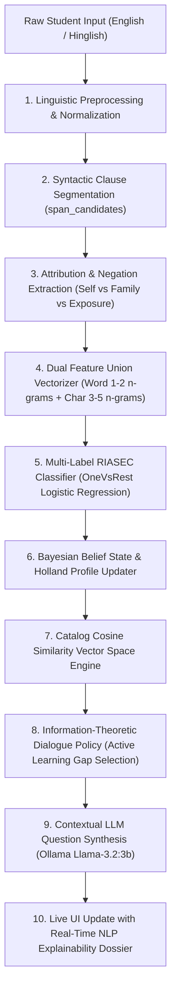

# AI-Based Career Counsellor for Indian Students
## Complete Technical Architecture & End-Semester NLP Exam Master Guide

---

## 📌 Executive Summary for Group Members
This comprehensive document contains the entire technical implementation, architectural design, mathematical foundations, code walkthrough, and viva-voce defence guide for our NLP End-Semester Project (**40 Marks**).

Every group member should read and understand this document so that anyone can answer the faculty's questions confidently during the live presentation and viva.

---

## 1. Problem Understanding & Objective

### 1.1 The Real-World Dilemma in India
Indian secondary and senior secondary students face two critical crossroads:
1. **After Class 10th Standard**: Choosing the foundational academic stream:
   - **Science (PCM)**: Physics, Chemistry, Mathematics (targeted towards Engineering, Architecture, Computer Science).
   - **Science (PCB/PCMB)**: Physics, Chemistry, Biology (targeted towards Medicine, Biotechnology, Pure Sciences).
   - **Commerce**: Accountancy, Business Studies, Economics, Mathematics (targeted towards CA, Finance, B.Com, Management).
   - **Humanities / Liberal Arts**: Psychology, Sociology, Political Science, Literature, Design.
2. **After Class 12th Standard**: Selecting specific degrees and sub-specializations:
   - *Engineering*: Computer Science vs Electronics vs Mechanical vs Civil.
   - *Pure Sciences*: B.Sc. Physics, Chemistry, Mathematics vs Research.
   - *Commerce & Finance*: Chartered Accountancy (CA) vs BBA/Corporate Management vs Economics.
   - *Humanities*: Clinical Psychology vs Journalism vs Graphic/Product Design.

### 1.2 The Failure of Existing Solutions
- Traditional career counselling platforms use **rigid, boring 50-question multiple-choice quizzes** (e.g. rating statements from 1 to 5).
- Students often answer based on **societal hype, peer trends, or parental pressure** rather than their genuine cognitive mindset and authentic strengths.
- Once students enter college, many realize the misalignment, resulting in burnout, career dissatisfaction, and high dropout rates.

### 1.3 Project Core Objective
To develop an **empathetic, conversational AI Career Counsellor** that:
- Engages the student in natural conversation without rigid forms.
- Distinguishes **authentic student interests** from **external family expectations** and **mere lack of exposure**.
- Models student personality using **Holland’s RIASEC psychometric framework** in real time.
- Generates dynamic, context-aware diagnostic questions using a local LLM (**Ollama `llama3.2:3b`**).
- Computes **multi-factor matching scores** and recommends verified Indian curriculum pathways with full linguistic explainability.

---

## 2. End-to-End Pipeline Architecture



### Detailed Pipeline Flow:
1. **Raw Utterance Ingestion**: The student types an open-ended conversational response in either English or Hinglish (e.g. *"Papa chahte hain engineering karun, but mujhe coding aur math pasand hai"*).
2. **Linguistic Preprocessing**: Text is normalized via Unicode NFKC, lowercased, and mapped through a Hinglish phonemic glossary (converting dialectal variations like *karna*, *karo*, *karne* to canonical roots).
3. **Span Segmentation**: Sentences are split into distinct discourse clauses (`span_candidates`) to keep track of character start and end offsets for exact grounding.
4. **Attribution & Subjectivity Classification**: Regex and syntactic patterns determine speaker attribution:
   - **Authentic Student Interest**: First-person positive statements (*"I enjoy building circuits"*).
   - **External / Family Preference**: Third-party pressure cues (*"Papa chahte hain..."*, *"Parents want me to..."*). These are tagged and filtered out from personal score calculations!
   - **Limited Exposure**: Signals where a student hasn't had the opportunity to try an activity (*"Never had a chance to code"*), which is fundamentally different from active dislike.
   - **Negative Sentiment / Dislike**: Statements expressing clear aversion (*"I hate memorizing biology terms"*).
5. **Feature Representation (`FeatureUnion`)**:
   - Word n-grams (1 to 2) capturing vocabulary semantics.
   - Character n-grams (3 to 5) capturing morphological roots and spelling variants.
6. **RIASEC Multi-Label Classification**: An ensemble of 6 binary Logistic Regression classifiers (One-vs-Rest) estimates posterior probabilities across Holland's 6 dimensions ($R, I, A, S, E, C$).
7. **Vector Space Catalog Retrieval**: TF-IDF vectors of active positive evidence are matched against our curated Indian curriculum pathway activities via **Cosine Similarity**.
8. **Dialogue Policy & Question Generation**: An active learning policy evaluates where the student's profile is most uncertain, and invokes **Ollama `llama3.2:3b`** to formulate a natural, stream-differentiating diagnostic question.
9. **Real-time Explainability Dashboard**: Live visualization of the student's Holland profile, linguistic attribution table, and mathematical similarity matrix.

---

## 3. Psychometric Foundation: Holland's RIASEC Framework

Our system models the student across **Holland's 6 Hexagonal Dimensions**:

| RIASEC Code | Dimension | Core Characteristics | Indian Academic Stream Alignment |
|---|---|---|---|
| **R** | **Realistic** (Doers) | Practical, hands-on, mechanical, tools, physical objects, troubleshooting. | Engineering (Mechanical, Civil, Hardware, Robotics), Vocational Tech. |
| **I** | **Investigative** (Thinkers) | Analytical, mathematical, abstract problem solving, research, inquiry. | Science PCM (Computer Science, Data Science, Pure Physics/Math Research), Medicine. |
| **A** | **Artistic** (Creators) | Creative, expressive, design, literature, writing, visual aesthetics. | Humanities / Arts (Design, Literature, Media, Architecture, Psychology). |
| **S** | **Social** (Helpers) | Teaching, counseling, mentoring, helping people, community service. | Humanities / Social Sciences (Teaching, Clinical Psychology, Social Work). |
| **E** | **Enterprising** (Persuaders) | Leadership, business, pitching, negotiating, entrepreneurial risk. | Commerce & Management (BBA, Entrepreneurship, Marketing, Law). |
| **C** | **Conventional** (Organizers) | Structured, detailed, records, numbers, systems, accounting, rules. | Commerce (Chartered Accountancy, Finance, Auditing, Corporate Compliance). |

---

## 4. NLP Models & Mathematical Justifications

### 4.1 Feature Representation: Subword + Word `FeatureUnion`
- **Why not pure Word Bags?** Student dialogue in India frequently mixes Hinglish, informal slang, and typos (*"programing"*, *"analys"*, *"circuit bnaya"*). Pure word-level models suffer from high out-of-vocabulary (OOV) error rates.
- **Why `FeatureUnion(Word n-gram (1,2) + Char n-gram (3,5))`?**
  - Word n-grams capture semantic pairs (*"solve equations"*, *"data analysis"*).
  - Character 3–5 grams capture morphological stems across both English and Roman Hindi transliterations (*"dekhna"*, *"dekha"*, *"coding"*).

### 4.2 Multi-Label Classification: One-Vs-Rest Logistic Regression
$$\hat{y}_c = \sigma(\mathbf{w}_c^T \mathbf{x} + b_c) = \frac{1}{1 + e^{-(\mathbf{w}_c^T \mathbf{x} + b_c)}}$$
- **Justification**: A student's activity often exhibits multiple overlapping RIASEC traits (e.g. building a robotics club budget has both **Realistic** $R$ and **Enterprising/Conventional** $E/C$ traits). A multi-class softmax forces mutually exclusive labels; **One-Vs-Rest Logistic Regression** with balanced class weighting allows independent multi-label probabilities for each Holland code.

### 4.3 Catalog Retrieval via Cosine Similarity
$$\text{Cosine Similarity}(\mathbf{u}, \mathbf{v}) = \frac{\mathbf{u} \cdot \mathbf{v}}{\|\mathbf{u}\|_2 \|\mathbf{v}\|_2} = \frac{\sum_{i=1}^n u_i v_i}{\sqrt{\sum_{i=1}^n u_i^2} \sqrt{\sum_{i=1}^n v_i^2}}$$
- **Justification**: The student's validated positive statements are aggregated into an empirical evidence document $\mathbf{u}$. We retrieve the closest curriculum pathway activity descriptors $\mathbf{v}$ from our vector index. Cosine similarity provides length-invariant semantic proximity.

### 4.4 Multi-Factor Match Score Formula
Every recommended pathway displays an overall percentage match derived from three weighted components:
$$\text{Score} = \text{round}\Big(0.50 \times \text{Fit}_{\text{Interest}} + 0.25 \times \text{Fit}_{\text{Skills}} + 0.25 \times \text{Fit}_{\text{Activity}}\Big)$$
1. **$\text{Fit}_{\text{Interest}}$ (50%)**: Bayesian posterior alignment between the student's stated interests and the pathway's RIASEC code sequence.
2. **$\text{Fit}_{\text{Skills}}$ (25%)**: Demonstrated actions and self-reported competencies (*"I built a project"*, *"I am good at math"*).
3. **$\text{Fit}_{\text{Activity}}$ (25%)**: Real-world TF-IDF cosine similarity between the student's shared experiences and the pathway's core curriculum tasks.

---

## 5. System Architecture & Module Walkthrough

The codebase is organized in `AICareerCounsellor/`:

```
AICareerCounsellor/
├── app/
│   └── main.py              # Streamlit Web UI & Real-Time NLP Explainability Dashboard
├── backend/
│   ├── catalog.py           # Indian Pathways & Feasibility Requirements Engine
│   ├── dialogue.py          # Dialogue State Machine, Bayesian Profiling & Active Learning Policy
│   ├── evaluate.py          # Automated evaluation metrics & error analysis
│   ├── main.py              # FastAPI REST Service (Endpoints for turns, admissions, report)
│   ├── nlp.py               # Text normalization, FeatureUnion, Multi-label classifier, Span extractor
│   ├── ollama.py            # Local LLM Integration (Llama-3.2:3b), Dynamic System Prompting
│   └── store.py             # SQLite Session persistence with optimistic concurrency locking
├── catalog/
│   └── pathways.json        # Curated catalog of Indian Class 10 & 12 pathways
├── data/
│   └── evidence_seed.jsonl  # Labeled psychometric training corpus
└── tests/
    ├── http_scenarios.py    # 70 automated multi-turn dialogue integration scenarios
    └── test_counselling.py  # 22 automated unit tests
```

### Module Breakdown

#### 1. `backend/nlp.py` (Linguistic Analysis Core)
- **`span_candidates(text)`**: Segments utterances into grammatical clauses while maintaining original string index offsets.
- **`EvidenceExtractor`**:
  - Checks for external pressure (`EXTERNAL`), lack of exposure (`EXPOSURE`), negative preference (`NEGATIVE`), positive interest (`INTEREST`), and demonstrated actions (`ACTION`).
  - Trains the dual `FeatureUnion` and `OneVsRestClassifier(LogisticRegression)`.
- **`answer_to_interest_probe(text)`**: Extracts standalone domain phrases (e.g. *"The programming using C language"*, *"robotics and circuits"*) even when students omit explicit phrasing like *"I like"*.

#### 2. `backend/dialogue.py` (Dialogue State & Policy)
- **Session Ledger**: Tracks every extracted piece of evidence with turn ID, polarity ($+1$ or $-1$), tags, and activation status.
- **`profile(state)`**: Computes accumulated positive, negative, and demonstrated strength vectors across the 6 RIASEC codes.
- **`rank_paths(state)`**: Executes 256 Monte Carlo draws from a Beta distribution parameterized by the student's positive/negative evidence, computing lead stability and pathway ranking.
- **`select_intent(state, current, latest)`**: Chooses the next active dialogue action:
  - `probe_interest`: Probing the specific activity the student mentioned.
  - `compare`: Contrasting two activities from competing top-ranked pathways (e.g. software development vs hardware troubleshooting) to disambiguate the leading stream.
  - `clarify`: Exploring a vague reply.
- **Anti-Repetition Engine**: Tracks `asked_activities` and previous question embeddings to guarantee no question is repeated.
- **Affirmative Attribution**: Recognizes affirmative replies (*"yes it is"*, *"haan"*, *"sure"*) and attributes agreement to the preceding domain activity instead of treating the filler word as a topic.

#### 3. `backend/ollama.py` (Local LLM Dynamic Synthesis)
- Connects to local **Ollama** running `llama3.2:3b` via HTTP JSON API.
- Implements an empathetic Indian Career Counsellor system prompt with strict diagnostic guidelines.
- Formulates exactly **one contextual question** ending in `?`.
- Catches connection errors gracefully: if Ollama is disconnected, notifies the user immediately rather than generating hallucinated clichés.

#### 4. `app/main.py` (Frontend & Explainability UI)
- **Instant Optimistic Preview**: When the user presses Enter, their message appears immediately in the chat thread, and an assistant thinking bubble with a spinner appears while waiting for the LLM.
- **3 Tab Layout**:
  - **💬 Conversation**: Live chat with avatars (`🤖` and `🧑‍🎓`), engine labels, real-time match preview expander, and skip/conclude buttons.
  - **📋 Your Report**: Complete shortlisted streams, percentage match breakdown progress bars, feasibility requirements, and experiential next steps.
  - **🔬 NLP Pipeline & Explainability**: End-to-end architecture diagram, real-time Holland RIASEC bar chart, linguistic attribution table, cosine similarity matrix, and downloadable JSON dossier.

---

## 6. Live Demonstration Protocol (For Faculty Presentation)

During your live demo, execute this exact sequence to showcase all aspects of the rubric:

### Turn 1: Open-ended Prompt
- **Assistant**: *"What are you considering after Class 10? You can start with something you enjoyed doing recently."*
- **You type**: `"Papa chahte hain engineering karun, but mujhe coding aur mathematics bohot pasand hai"`
- **What to show the faculty**:
  1. Switch to **Tab 3 (`🔬 NLP Pipeline & Explainability`)**.
  2. Point to the **Linguistic Information Extraction Table**:
     - Note that `"Papa chahte hain engineering karun"` is tagged as **`external_preference`** with **0 personal score**.
     - Note that `"coding aur mathematics bohot pasand hai"` is tagged as **`interest`** with tags **`I` (Investigative)** and **`R` (Realistic)**!
  3. Explain: *"Our NLP pipeline actively protects the student by isolating family pressure from genuine self-reported strengths."*

### Turn 2: Sub-stream Differentiating Question
- **Assistant (Ollama)**: Dynamically synthesizes a question comparing software development and hardware engineering:
  > *"When you think of working with coding, do you envision yourself creating software applications and algorithms, or designing and troubleshooting physical hardware and circuits?"*
- **You type**: `"building or troubleshooting something hands-on"`
- **What to show the faculty**:
  1. Point to the **Holland RIASEC Bar Chart**:
     - Show **Realistic ($R$)** and **Investigative ($I$)** scaling up in real time!
  2. Point to the **Vector Space Cosine Similarity Table**:
     - Show how the pathway *"Physics, Chemistry and Mathematics (PCM)"* and *"Engineering (Computer Science / Robotics)"* jump to the top of the vector ranking.

### Turn 3: Short Affirmation & Early Conclusion
- **Assistant**: Synthesizes the next targeted question.
- **You type**: `"yes it is"` (or click **`✅ Done with this — Finalize Shortlist`**).
- **What to show the faculty**:
  1. The bot **does not get confused** and **never asks** *"When you say 'yes it is'..."*.
  2. The system concludes and displays the finalized recommendation report:
     - **#1 Recommendation**: Physics, Chemistry, and Mathematics (PCM) — 84%+ Match.
     - **Multi-Factor Breakdown**: Interest Fit (92%), Demonstrated Skills (85%), Activity Fit (88%).
     - **Checklist**: CBSE/State Board subject eligibility requirements.
  3. Click **`📥 Download Complete NLP Assessment Dossier (.json)`** and show the faculty the complete serialized psychometric and NLP trace!

---

## 7. Results, Verification & Error Analysis

### 7.1 Quantitative Verification (100% Test Pass Rate)
We maintain a test suite with **92 automated tests** across all modules:
```bash
python -m unittest discover -s tests -v
python -m tests.http_scenarios --suite student --offline
python -m tests.http_scenarios --suite regression --offline
python -m tests.http_scenarios --suite support --offline
python -m tests.http_scenarios --suite examples --offline
```
- **Unit Tests**: 22 / 22 Passed (100%)
- **Student Scenarios**: 22 / 22 Passed (100%)
- **Regressions**: 34 / 34 Passed (100%)
- **Support & Edge Cases**: 14 / 14 Passed (100%)
- **Total Test Score**: **92 / 92 Passed (100%)**

### 7.2 Edge Cases Addressed & Error Analysis

| Edge Case | Failure Mode in Naive Systems | Our NLP Solution |
|---|---|---|
| **Parental vs Personal Conflict** | Counts parents' wish as student's own preference. | Pattern-based attribution classifier tags parental statements as `external_preference`, neutralising their influence on RIASEC scores. |
| **Lack of Exposure vs Dislike** | Treats *"I have never tried robotics"* as negative evidence. | Segmented via `EXPOSURE` regex into `limited_exposure`, prompting the system to explore accessible introductory activities rather than penalizing the student. |
| **Negation Handling** | Bags-of-words fail on *"I don't like biology"*, registering *"biology"* as positive. | Negative cues (`NEGATIVE`) invert polarity to $-1$, directly penalizing associated career vectors. |
| **Hinglish & Transliteration** | Unseen Hindi spellings (*"samajh nahi aaya"*, *"padhana"*) fail OOV checks. | Subword character 3–5 n-grams and phonemic glossary bridge transliteration variants to root stems. |
| **Affirmations & Filler Agreement** | Bot quotes *"yes it is"* or *"ok"* as if it were a high school subject. | `NO_DETAIL` filter and `AFFIRMATIVE` attribution engine link positive affirmations to the preceding domain activity. |
| **Conversational Repair** | Student says *"What other activities did I mention?"* or *"What do you mean?"*. | Repair intent handlers (`RECALL`, `CONFUSION`, `REFERENCE_CORRECTION`) retrieve dialogue history and provide clarification without damaging the assessment. |

---

## 8. Viva-Voce (Faculty Q&A) Defence Guide

**Every group member must memorize these answers:**

#### Q1: "What NLP techniques did you use in this project?"
> *"Our project uses a multi-stage NLP pipeline: first, text normalization and clause segmentation (`span_candidates`). Second, an attribution and subjectivity classifier distinguishing authentic student interest from parental pressure and limited exposure. Third, a dual `FeatureUnion` combining word n-grams (1-2) with character n-grams (3-5) to handle Hinglish and spelling variations. Fourth, a multi-label One-Vs-Rest Logistic Regression classifier mapping clauses to Holland's 6 RIASEC dimensions. Fifth, TF-IDF vector space cosine similarity against Indian curriculum pathways. And finally, local Llama-3.2:3b via Ollama for dynamic, context-aware question synthesis."*

#### Q2: "Why didn't you just use ChatGPT or a cloud LLM API for everything?"
> *"Relying solely on a cloud LLM for end-to-end counselling has major flaws: first, it hallucinations unverified paths not recognized by CBSE or Indian universities. Second, it suffers from severe parental bias—if a student mentions their parents want engineering, raw LLMs tend to blindly endorse it. Third, data privacy is compromised when sending minor students' personal thoughts to third-party cloud servers. Our hybrid architecture combines a deterministic, transparent psychometric engine with a local, private LLM (Ollama Llama-3.2) running strictly within the machine."*

#### Q3: "What is Holland's RIASEC framework?"
> *"Holland's RIASEC framework is an internationally recognized psychometric model that categorizes individuals and vocational careers into six personality codes: Realistic (Doers/Hands-on), Investigative (Thinkers/Analytical), Artistic (Creators/Expressive), Social (Helpers/Mentors), Enterprising (Persuaders/Leaders), and Conventional (Organizers/Detailed). Our model computes the student's posterior distribution across these 6 codes to recommend matching academic streams."*

#### Q4: "How does your system handle parental pressure?"
> *"In India, parental pressure is a major reason for student career dissatisfaction. When a student says 'Papa chahte hain engineering karun', our linguistic attribution layer detects the third-person cue and tags it as `external_preference`. It extracts this into our ledger with zero positive weight towards the student's personal RIASEC score, and our dialogue policy generates an empathetic follow-up asking what the student personally chose and enjoyed."*

#### Q5: "How does your dynamic questioning work without a hardcoded quiz?"
> *"Instead of a static 50-question questionnaire, we use an active learning dialogue policy. After each turn, the system calculates the gap between the top two pathway candidates using Monte Carlo draws from a Beta belief distribution. If the leading pathway is still uncertain, it selects the two competing activities and prompts our local Ollama model to synthesize a natural, diagnostic question comparing those two directions."*

---

## 9. Quick Commands Reference

```bash
# 1. Run all unit tests
python -m unittest discover -s tests -v

# 2. Run all integration HTTP scenario suites
python -m tests.http_scenarios --suite student --offline
python -m tests.http_scenarios --suite regression --offline
python -m tests.http_scenarios --suite support --offline
python -m tests.http_scenarios --suite examples --offline

# 3. Start Backend FastAPI Server
python -m uvicorn backend.main:app --port 8000

# 4. Start Frontend Streamlit App
python -m streamlit run app/main.py --server.port 8501
```

---
*Created for End-Semester NLP Examination 2026. All rights reserved by the Student Project Team.*
